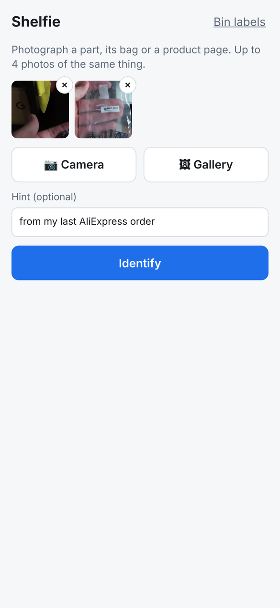
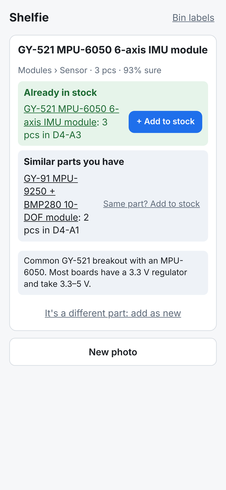
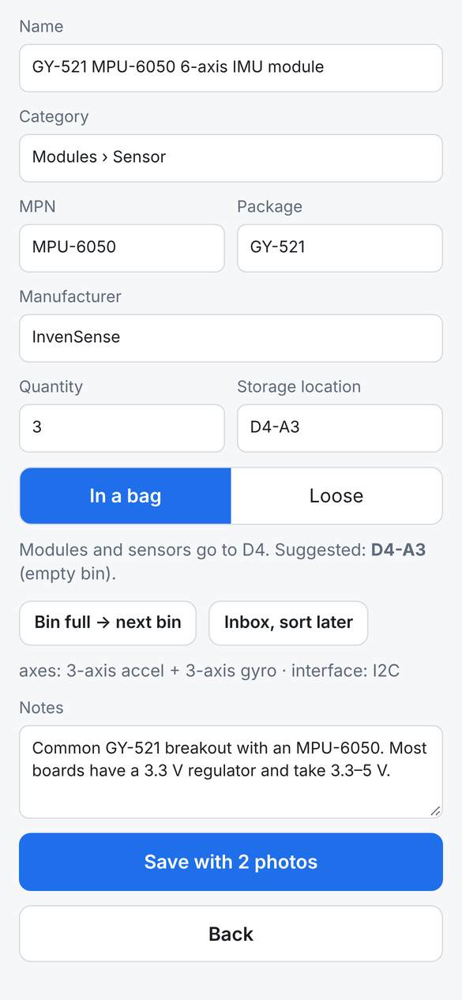
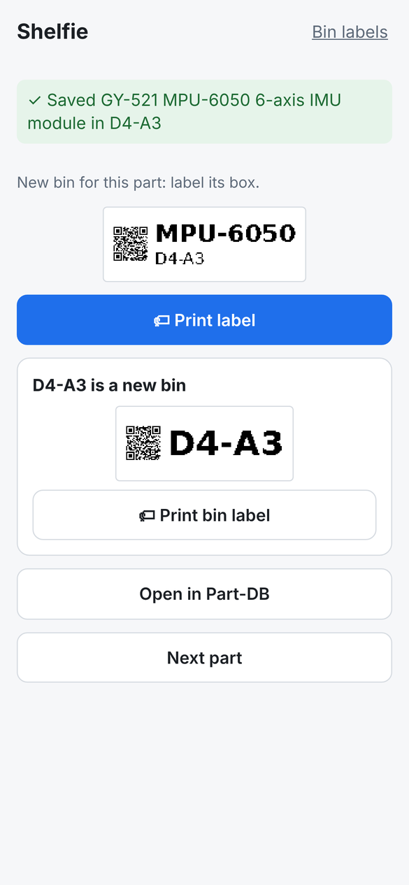

# Shelfie

**Snap a part. Know what you have.**

Shelfie is a self-hosted inventory for electronic parts. Point your phone camera at a part, its bag or an AliExpress listing, and Shelfie identifies it with AI, checks whether you already own it, and adds it to your inventory, label included.

It exists to solve one very specific problem:

> You order a part on AliExpress, wait three weeks for it to arrive, and then find the same part in a box you already had.

<table>
  <tr>
    <td align="center" width="25%"><br><sub><b>1. Snap</b> a part, its bag or a listing</sub></td>
    <td align="center" width="25%"><br><sub><b>2. Already have it?</b> Stock and bin at a glance</sub></td>
    <td align="center" width="25%"><br><sub><b>3. Review</b>, with a suggested bin</sub></td>
    <td align="center" width="25%"><br><sub><b>4. Saved</b>, QR labels ready to print</sub></td>
  </tr>
</table>

<sub>Screenshots of the capture PWA with sample data.</sub>

---

## Features

- **Photo capture**: take a photo of a part, its packaging or a product page; an AI vision model extracts name, MPN, manufacturer, category and package.
- **"Do I already have it?"**: before ordering, share a screenshot or link and Shelfie searches your inventory: *"3 in Box 4."*
- **Proper electronics inventory**: built on [Part-DB](https://github.com/Part-DB/Part-DB-server), with categories, footprints, storage locations, stock lots, datasheets and parameters.
- **Labels on demand**: prints QR-code labels on a Brother P-touch P700 via a Raspberry Pi print server.
- **A physical home for every part**: Gridfinity bins in an IKEA Helmer drawer unit, each bin a storage location in Part-DB, with 3D-print files generated from one plan file.
- **Private by default**: everything is reachable over Tailscale; the capture app and Part-DB are also reachable through Cloudflare Tunnels behind a GitHub login (no open ports).
- **Portable**: one `docker compose` stack plus two data folders. Moving hosts takes an evening, not a weekend.

## Architecture

```
  📱 Phone (PWA)                      ☁️  Azure VM (docker compose)
  ┌─────────────┐   Tailscale     ┌──────────────────────────────────┐
  │ capture-web │ ─────────────▶  │ capture-api  (ASP.NET Core)      │
  └─────────────┘                 │   │                              │
                                  │   ├──▶ Part-DB (SQLite)          │
                                  │   └──▶ Azure OpenAI (vision)     │
                                  └───────────────┬──────────────────┘
                                                  │ Tailscale
                                                  ▼
                                  🏠 Raspberry Pi 3: print-server (FastAPI)
                                                  │ USB
                                                  ▼
                                           🖨️  Brother P-touch P700
```

### Capture flow

1. Take a photo in the PWA, which uploads it to `capture-api`.
2. `capture-api` sends the image to the vision model and receives structured JSON (name, MPN, manufacturer, category, package, confidence).
3. `capture-api` searches Part-DB for matches. If one exists, the app shows where it is.
4. Otherwise you review the suggested fields, confirm, and the part, stock lot and photo are created in Part-DB.
5. `capture-api` asks the Pi print server to print a QR label linking to the part.

## Physical storage

Parts live in **Gridfinity bins in an IKEA Helmer** (6 drawers), plus a small **Multiboard wall area** next to the desk.

- **Drawers:** inside 230 × 390 × 85 mm → a **5 × 9 Gridfinity grid** per drawer, bins up to **6u** tall (4u in the back rows 7–9, which are only reachable with the drawer partly under the one above; D6 for bulky items at 9u). Each drawer gets a 5×5 and a 5×4 baseplate with the leftover space built in as padding (9.5 mm at the sides, 11 mm at the back), so no separate spacers are needed.
- **What goes where:** D1 small loose parts (bins with compartments), D2–D3 bagged AliExpress parts standing upright, D4 modules, D5 dev boards, D6 cables and tools. 55 bins in total, no 1×1 bins.
- **Wall:** `W-INBOX` for new parcels waiting to be captured, `W-PROJECT` for parts in use.
- **Naming:** a bin is named after its front-left cell (`D2-A1`) and is a storage location in Part-DB (`Helmer › D2 › D2-A1`). Names describe positions, so labels stay valid when contents change.

### Print files

The layout lives in one file, **`storage/plan.json`**. **`storage/generate.py`** validates it and renders the STL files with [cqgridfinity](https://github.com/michaelgale/cq-gridfinity):

```bash
python3 storage/generate.py --check       # validate, show drawer layouts and print list (no CAD needed)
uv run storage/generate.py                # render all baseplates and bins to storage/out/
uv run storage/generate.py --only baseplate_5x5
python3 storage/generate.py --locations   # Part-DB storage location names
```

**`storage/plates.py`** packs the bins still to be printed onto full A1 plates (one colour each) and writes ready-to-slice 3MF files, with how often to print each plate.

The validator rejects plans where bins overlap, leave the grid or are too tall for the drawer. Each distinct part is rendered once; `storage/out/print-list.md` lists quantities, colours and which bin each file is for.

### Print settings

**`storage/bambu/shelfie-gridfinity-a1.json`** is a Bambu Studio process preset for the **Bambu Lab A1**, tuned for speed and low filament use. Import it with *File → Import → Import Configs*; it appears as "0.28mm Shelfie Gridfinity @BBL A1".

It builds on Bambu's official *0.28mm Extra Draft @BBL A1* profile and changes only: 2 walls with the Arachne wall generator, 3 top and 3 bottom layers, 10 % lightning infill with infill combination, no supports. Speeds stay at Bambu's values, since at 0.28 mm the A1 is limited by how fast the hotend melts PLA.

Full details, drawer layouts, colours and the wall plan: **[docs/storage.md](docs/storage.md)**.

## Components

| Component | Technology | Runs on |
|---|---|---|
| Inventory | Part-DB (official Docker image), SQLite | Azure VM |
| Capture backend | ASP.NET Core minimal API, OpenAI .NET SDK | Azure VM |
| Capture frontend | React + Vite PWA | served by the backend |
| Vision | Azure OpenAI multimodal model, JSON-schema structured output | Azure |
| Networking | Tailscale sidecar containers (HTTPS via `tailscale serve`) | Azure VM |
| Print server | Python FastAPI, Pillow, `segno`, `ptouch-print`; docker compose + Tailscale sidecar | Raspberry Pi 3 |
| Infrastructure | Terraform, cloud-init, Ubuntu 24.04 LTS | Azure |
| Backups | nightly `sqlite3 .backup` + uploads, rsync over Tailscale | → Synology |
| Storage bins | Gridfinity via cqgridfinity (CadQuery), Bambu Studio preset | Mac → Bambu Lab A1 |
| CI | GitHub Actions → GitHub Container Registry | GitHub |

## Repository layout

```
shelfie-parts/
├── infra/          # Terraform: VM, network security group, Azure OpenAI deployment
├── deploy/         # docker-compose.yml, Tailscale sidecar config, .env.example
├── capture-api/    # ASP.NET Core minimal API
├── capture-web/    # React + Vite PWA
├── print-server/   # FastAPI print service for the Pi (own compose stack + Tailscale sidecar)
├── vision/         # vision prompt, JSON schema, identify.py test CLI
├── storage/        # plan.json (drawers and bins), generate.py (Gridfinity STLs), plates.py (A1 plates as 3MF), bambu/ (A1 print preset)
├── scripts/        # backup.sh, update.sh, notify.sh (ntfy)
├── brand/          # logo and app icons (SVG masters, rendered PNGs, render.mjs)
└── docs/           # getting-started.md, storage.md (Gridfinity bins in an IKEA Helmer), what-goes-where.md, drawer-layouts.md
```

**→ Setup: [docs/getting-started.md](docs/getting-started.md)**

## Design principles

- **Portability first.** Azure provides only a Linux VM and the vision model. Everything else is containers, with images published to GHCR, not tied to any cloud registry.
- **Swappable AI.** The vision provider sits behind an OpenAI-compatible client; switching providers is a configuration change.
- **No open ports.** The VM's network security group blocks all inbound traffic. Access, SSH included, goes through Tailscale.
- **Backups off-cloud.** Data is copied nightly to the home NAS, so losing the cloud subscription never means losing the inventory.
- **Nothing exposed at home.** No port forwarding; the print server is reachable only from the capture API, via Tailscale ACLs.

## Roadmap

**App and infrastructure**
- [x] Infrastructure: Terraform for the Azure VM and Azure OpenAI deployment
- [x] Part-DB behind a Tailscale sidecar (docker compose)
- [x] Vision prompt, JSON schema and `identify.py` test CLI, tuned with real parts
- [x] Print server on the Raspberry Pi 3 (P700 via `ptouch-print`)
- [x] Capture API: identify → search → create → print
- [x] Capture PWA in daily use: photos → stock check → bin suggestion → part and bin labels
- [x] Storage locations in Part-DB (109 bins) and QR bin labels from the app
- [x] CI: build and publish the capture API image to GHCR
- [x] Public access without Tailscale: capture app and Part-DB through Cloudflare Tunnel + Access (GitHub login)
- [x] Nightly backups to the Synology (rsync service, dedicated backup user)
- [x] Part-DB pinned, automatic minor updates with backup, health check and ntfy notifications
- [ ] App in the brand colours (icons done)
- [ ] "Do I already have it?" from AliExpress screenshots and product links (works in principle, not tested enough)
- [ ] Vision tuning for passives and product-page screenshots

**Physical storage**
- [x] Storage plan for the IKEA Helmer and the Multiboard wall
- [x] Gridfinity generator (`storage/generate.py`), plate packer (`storage/plates.py`) and A1 print presets
- [x] Baseplates printed and fitted; bin heights adapted to how far the drawers open
- [x] Drawer labels (D1–D6) in the bin colours
- [ ] Print the remaining bins (D6 and D2's front bins done)
- [ ] Multiboard wall: `W-INBOX` and `W-PROJECT`

## Status

✅ In use. Part-DB, the capture API, the PWA and the label printer run end to end, from the phone and away from home. The first parts are captured, labelled and stored in the Helmer; the remaining Gridfinity bins are being printed.

## License

Not decided yet.
